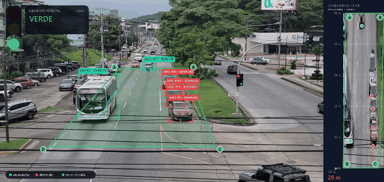
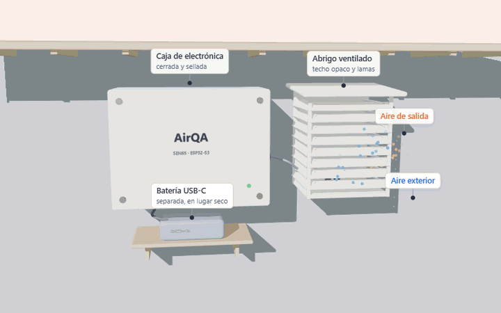

## Hola, soy Salvatore 👋

Soy desarrollador y vivo en Ciudad de Panamá.

Hace tiempo que veo cómo en la ciudad se lanzan proyectos de tecnología que le debería interesar a la gente: las cámaras fotomultas, los semáforos inteligentes... Y siempre me quedo pensando en que tengo una idea bastante clara de cómo están hechos por dentro.

Así que decidí hablar sobre ellos, aunque sea a una escala más pequeña, y mostrar el proceso. La idea es que cualquiera pueda entenderlo, sepa o no de programación.

Los videos los subo a [LinkedIn](https://www.linkedin.com/in/mrscannavo), y aquí en GitHub dejo el código de cada proyecto para quien quiera verlo por dentro.

### Lo que viene

#### 🚦 Semáforos inteligentes &nbsp;

La historia de los semáforos inteligentes en Panamá: desde la versión de 2005 hasta la propuesta con cámaras e IA de 2026, con demos de detección usando YOLO.

`Python` `YOLO` `three.js`

---

#### 🌫️ AirQA &nbsp;

Un medidor de calidad del aire hecho por mí, con un sensor SEN65. La idea es armar el dispositivo, recoger datos y mostrarlos.

`Hardware` `Sensores` `Datos`

---

Si tienes una idea o quieres armar algo juntos, escríbeme por LinkedIn.
